# orca

An orca lives on your Windows desktop. It swims over every window, hunts salmon, and dives off into the deep after each catch. You can keep working the whole time, because clicks go straight through it.

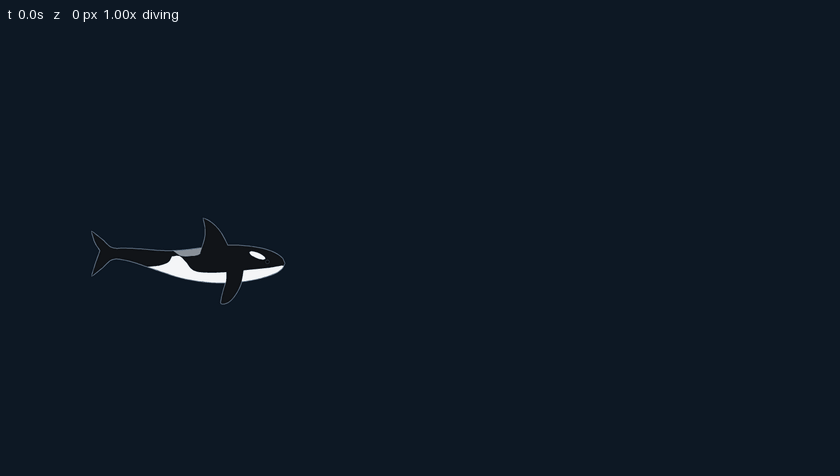

## Start it

You need Windows, Python 3.12, Pillow and numpy.

```
pip install pillow numpy
python orca.py
```

To stop it, press `Ctrl+Alt+O` from any window, or press `Ctrl+C` in the console that started it.

## What you see

A salmon swims in, sometimes from a screen edge and sometimes out of the haze in the distance. The orca notices it after a few seconds and starts to stalk it. The salmon bolts when the orca gets within about three body lengths. It dodges from side to side, and it may dive away from you or dart toward you.

When the orca is close and lined up, it lunges with its jaw open. A hit ends with the jaw snapping shut, a shake of the head and a burst of bubbles. A miss sends it back to stalking, so some hunts take two or three tries. A catch comes about every 15 seconds on average.

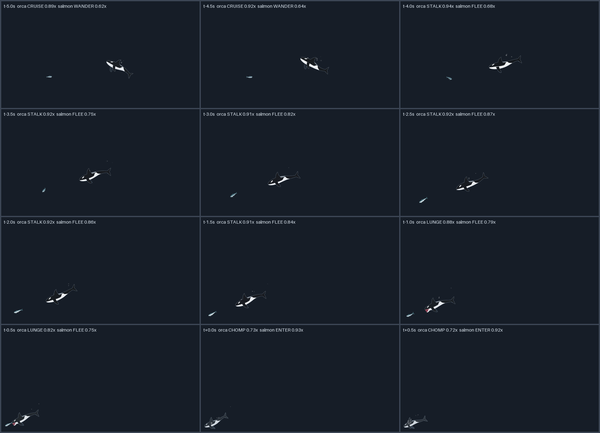

After a catch the orca swims off into the deep. It gets smaller, paler and slower until it is about a third of its size, then comes back for the next salmon. The orca spends about a quarter to a third of its time deep, and the salmon stays near the front, so most hunts happen close to you. Whichever animal is nearer to you is drawn in front of the other.

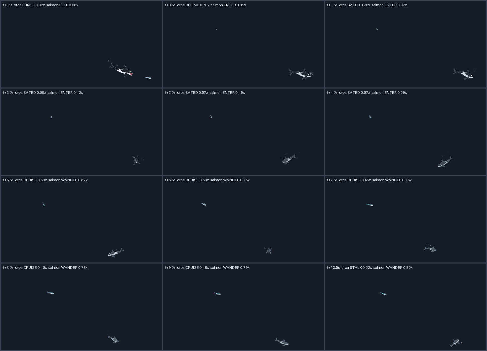

Both animals turn in 3D. The head swings round first and the body follows, so the animal curves through depth, banks into the turn and spreads its flippers. Seen nose-on, the dorsal fin is a blade and the flippers are paddles.

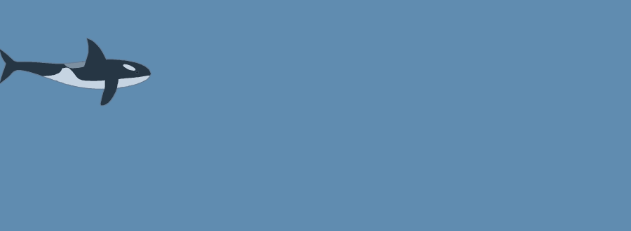 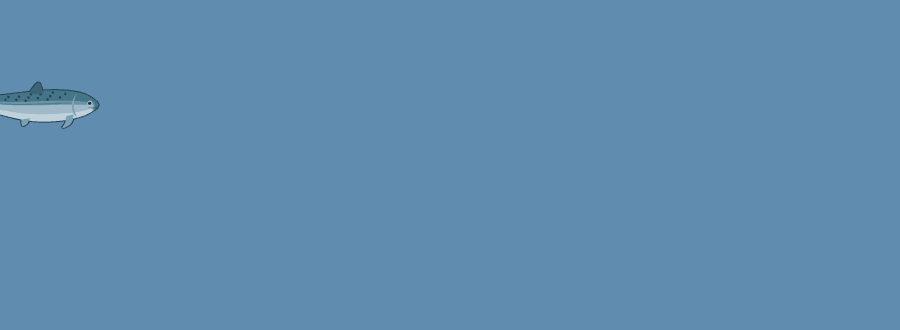

## It stays out of your way

- Mouse clicks go through both animals to the window underneath.
- Neither animal takes focus or has a taskbar button.
- The animals stay on top of other windows.
- It draws 60 frames per second. Drawing both animals takes about 9 ms per frame on average, measured on a 1920x1080 screen.

## How it got here

The project grew over one conversation, one request at a time.

**A single orca.** The first request was an orca that swims across the screen. It crossed from one edge to the other and came back the other way, with its tail beating and bubbles rising from its blowhole.

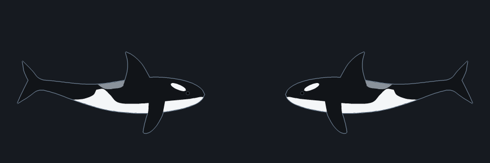

**Something to hunt.** Next the orca got a Chinook salmon to chase, the real prey of many orcas. The orca stalks, lunges with its teeth showing and catches the fish in a burst of bubbles.

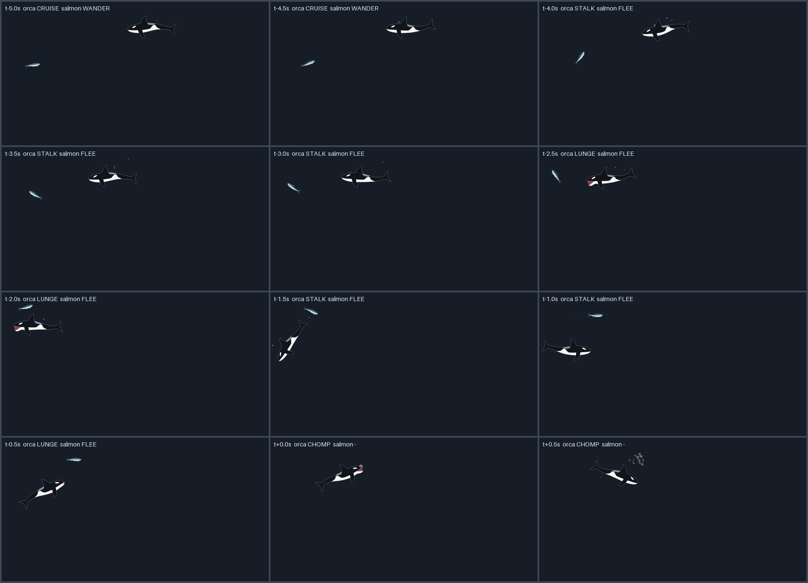

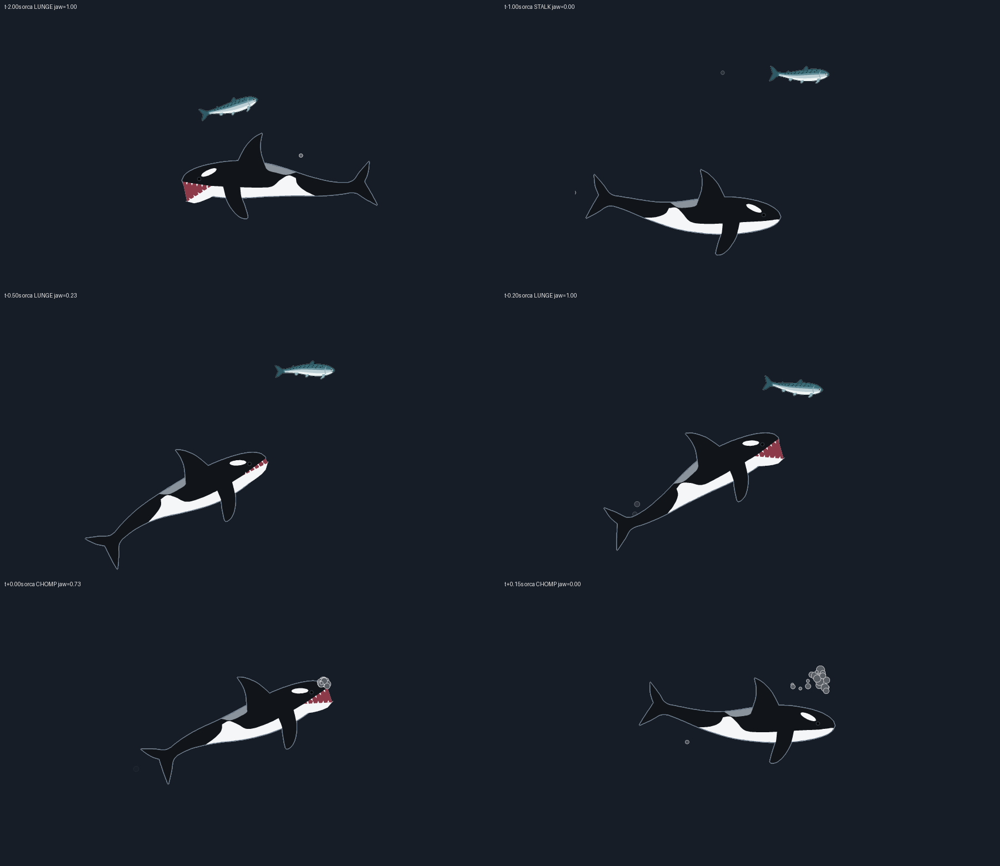

**Turns that feel 3D.** At first a turn was a flat squash. The sprite narrowed to a sliver and widened again the other way.

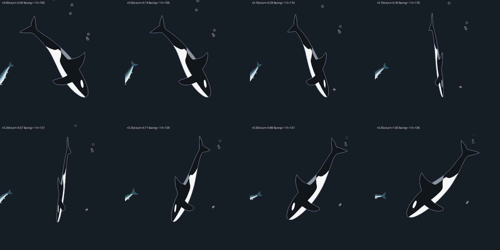

To find a better turn, three versions were built side by side. A gave the body real width and let the head lead the tail. B rendered each animal as a real 3D model with lighting. C made the turn a U-turn through depth, so the animal grows as it comes toward you, rolls into the turn and hazes as it moves away. C was the pick, and it is the turn the animals use now.

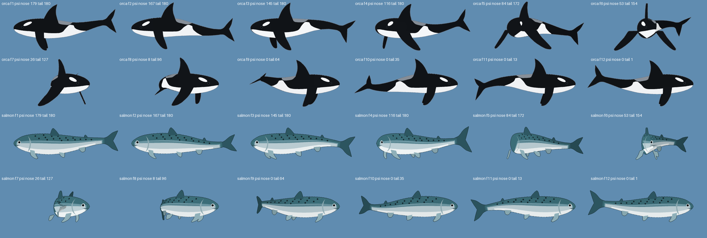

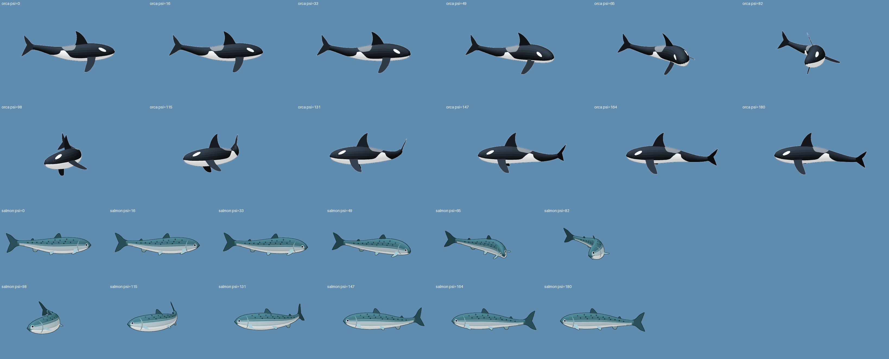

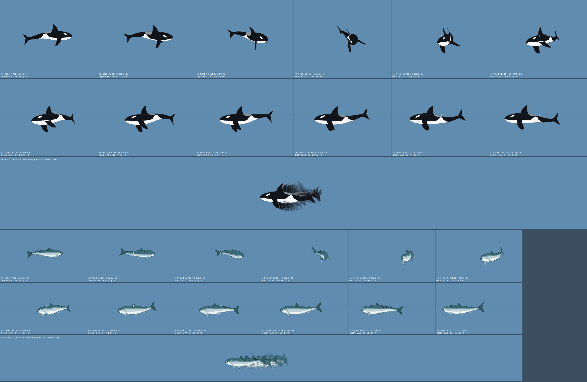

**Real depth.** The last request was for the orca to swim away into the screen. Depth became a real place to be, not only part of a turn. The orca dives into the distance, the salmon rises out of the haze, and the nearer animal draws in front.

## Watch it without a window

These flags render to files instead of your desktop, so you can look at the animation frame by frame. Each one exits when it finishes.

| Flag | Output |
|---|---|
| `--film out.png` | Twelve frames of one hunt, half a second apart |
| `--dive out.png` | Twelve frames a second apart after a catch, as the orca goes deep and returns |
| `--turns out.png` | Twelve frames across a turn toward you and a turn away, for both animals |
| `--depth-gif out.gif` | An animated dive into the deep and back |
| `--turn-gif PREFIX` | `PREFIX-orca.gif` and `PREFIX-salmon.gif`, a few turns each |
| `--sheet out.png` | The tail beats and the orca's jaw at three openings |
| `--sim SECONDS` | A headless run that prints every event and a summary of catches, cycle times and depth |
| `--frames N` | A live run of N frames that prints frame times |

Add `--seed N` to any of these, or to a normal run, to repeat the same swim exactly. The images in this README came from these flags. For example, `python orca.py --seed 1 --film docs/media/hunt.png` makes the hunt sheet.

While it runs, the console prints what the animals do, for example `[  20.73s] orca STALK -> LUNGE` or `[  15.55s] orca DEEP at (1748, 649) 0.54x`.

## Known limits

- It runs only on Windows. It has been tested on Windows 11 with one 1920x1080 monitor. Other monitor setups and display scaling are untested.
- During a chase near a screen edge, the orca can swim far enough that part of its fin is cut off.
- Seen almost nose-on, a thin white sliver of belly can show across the orca's face.
- On a turn away from you, the eye patch is not hidden behind the nearer part of the body.
- The longest tested run is 10 minutes.
